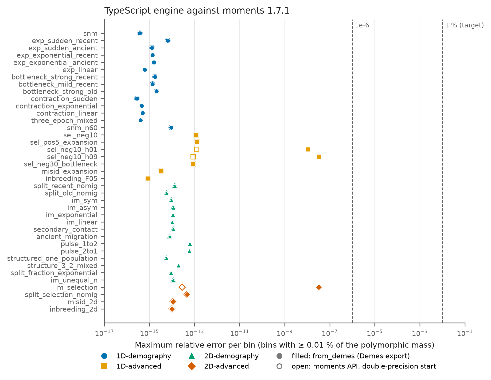
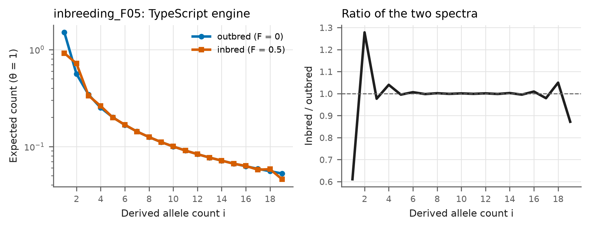
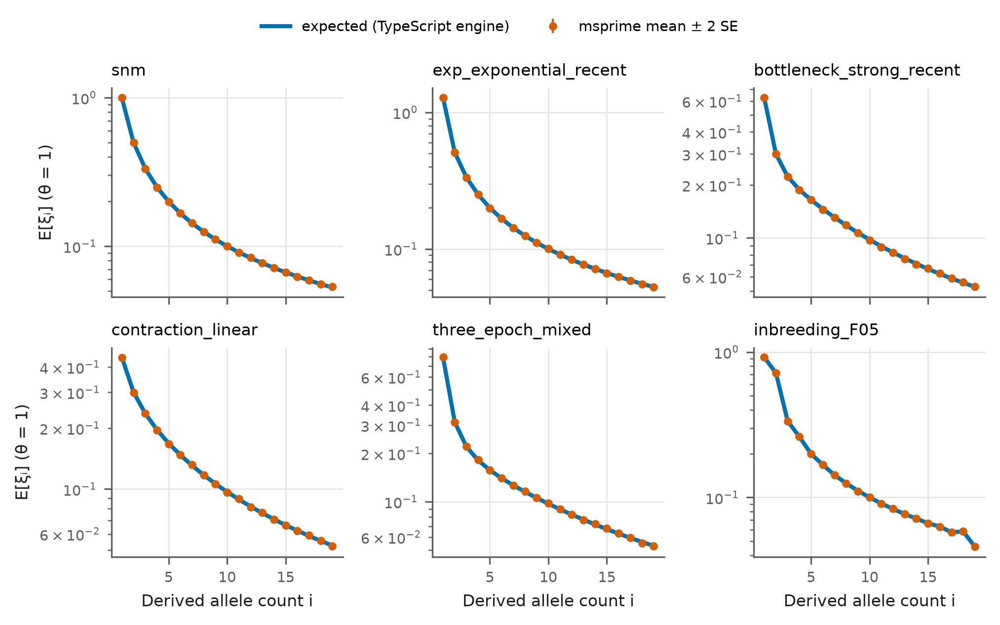
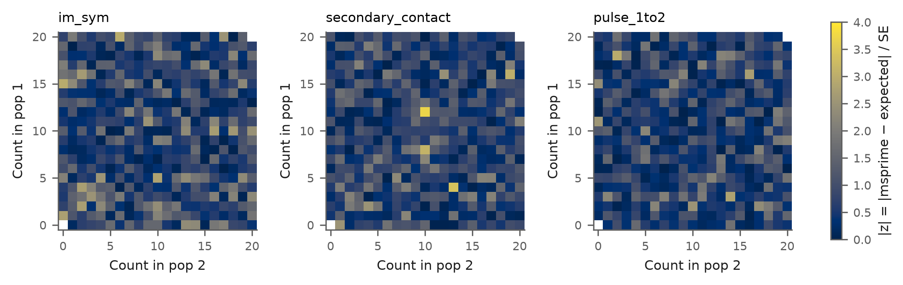
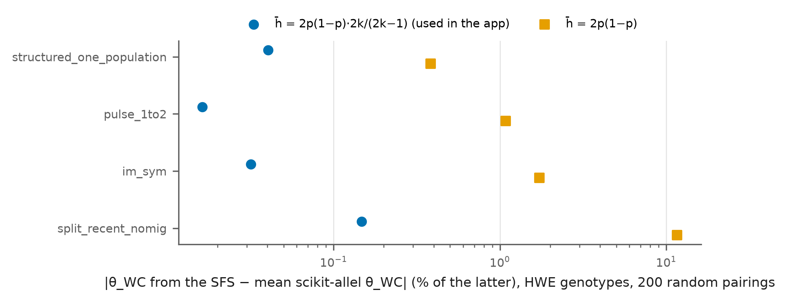
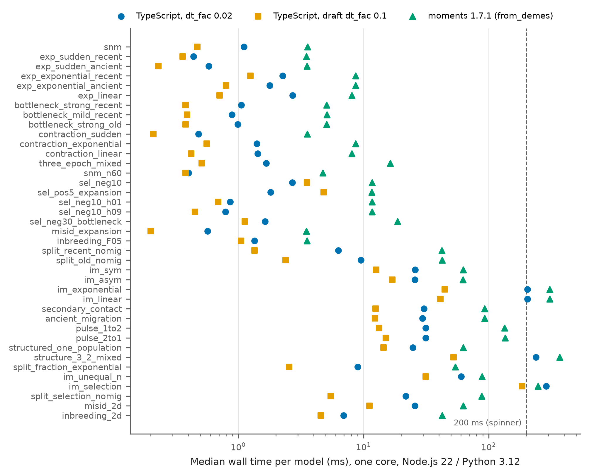

# Validation report: the SFS engine and the SFS statistics

*Phase 1 report (STOP 2), 2026-11-18. App version 0.1.0-beta (not yet released).*
*Tables between `AUTO` markers and all figures are generated by `validation/make_validation_report.py` from the outputs of the SLURM jobs listed in Section 10. Do not edit them by hand.*

The app computes expected site frequency spectra (SFS) in the browser with its own TypeScript engine. The engine is a port of the moment equations of moments 1.7.1 [@jouganous2017inferring]. This report checks four things:
1. the engine against the established software it was ported from;
2. the engine against independent methods;
3. the engine against simulation;
4. the SFS-based statistics against three established packages.

## Summary

- **Engine against moments 1.7.1** (39 test models: every preset, all three dynamics types, migration masks, admixture pulses in both directions, selection, dominance, misidentification): all 39 models agree within 1e-6, most at 1e-13 to 1e-16, which is rounding error. The target was 1 %.
  - The three largest differences (1e-8 to 3.4e-8) are in the models with h ≠ 0.5, and they come from moments itself. Its steady-state routine is a Cython function with single-precision (`float`) arguments, so it rounds h to float32.
  - Called with a double-precision start, moments agrees with the engine to 1.2e-13 or better for these three models.
- **Folding, marginal spectra and the pooled sample** agree with moments to rounding error, and the masks of the folded spectra are identical.
- **Independent checks:**
  - The standard neutral model gives E[ξᵢ] = θ/i to 1e-13 or better.
  - Neutral one-population models agree with a coalescent calculation that shares no code with the engine, within 2e-4 (fine time step) and 2e-3 (default time step).
  - Under selection, the engine converges to the exact equilibrium of the diffusion. This confirms the selection convention (fitnesses 1, 1 + 2hs, 1 + 2s; γ = 2N_ref·s).
- **Inbreeding against dadi 2.4.3** [@blischak2020inferring]: the engine's exact inbreeding transform and dadi's beta-binomial integral agree to 5.6e-4 (1D) and 1.3e-3 (2D) on dadi's finest grids, and the agreement improves as the grid is refined. The remaining differences between the two programs come from dadi's own numerical solution (Section 2).
- **Simulation (msprime):** 28 neutral models were simulated, 4,000 replicates each (Section 3).
  - With migration and a small sample (10 chromosomes in one population), the expected SFS of moments, and so of the engine, was 1.4–2.9 % off in the main bins. This is the jackknife closure for migration. The app therefore now integrates each population at 20 or more chromosomes when migration is on, and then projects. With this, the model agrees with msprime.
  - The remaining isolated deviations are discussed in Section 3.
- **Statistics:** all 242 comparisons with tskit [@ralph2020efficiently], scikit-allel and egglib [@siol2022egglib] agree to within 1e-9.
  - The statistics compared are π, S, Tajima's D, Fu and Li's D, F, D* and F*, Fay and Wu's H (raw and normalised), Zeng's E, θ_H, θ_L, d_xy, both F_ST definitions, and Weir and Cockerham's θ from genotype counts.
  - Weir and Cockerham's θ computed from the SFS, with the corrected heterozygosity term, agrees with the mean of scikit-allel over random pairings to Monte Carlo precision.
- **Speed** (one core of an older server CPU, Xeon Silver 4114 at 2.2 GHz):
  - one-population models take 0.4–2.7 ms;
  - two-population models with constant sizes take 6–60 ms;
  - the slowest cases take 200–290 ms at full accuracy and 41–185 ms in draft mode: migration with continuous size change, and selection in two populations (computed at 40 × 40);
  - the engine is faster than moments for 38 of the 39 models. The exception is two-population selection with migration (288 against 248 ms), where moments' sparse solver beats the engine's banded solver at 40 × 40.
  - Section 8 has the details.

## 1. Engine against moments 1.7.1

**Method.**
- **Test models:** `validation/models.csv`, built by `validation/make_validation_models.py`, has 39 models.
- **Engine output:** for each model, the TypeScript engine (Node.js command-line tool `app/scripts/engine_cli.ts`) writes the expected SFS for θ = 1, and **exports the model as a Demes YAML file** [@gower2022demes].
- **Reference:** moments computes the SFS from that same YAML file (`moments.Spectrum.from_demes`, default time step `dt_fac` = 0.02). It uses the same internal sample sizes, then projects.
- **What this tests:** the integration, the events, and the Demes export at the same time.
- **Second reference path, for models without a pulse and with sudden size changes only:** the same model is built with moments' own functions (steady state, `integrate`, `split`), starting from a steady state solved in double precision.
- **Error measure:** the largest relative difference per bin, over bins that hold at least 0.01 % of the polymorphic mass (the two monomorphic corners excluded).
- **Folding:** the engine's folded spectrum is compared with moments' `fold()`, values and mask, for 1D and 2D.
- **2D views:** the marginal spectra are compared with `marginalize`, and the pooled sample with `Manips.merge_2D_to_1D`.

<!-- AUTO:engine_moments -->
*39 of 39 models within 1 %; 39 of 39 within 1e-6; largest error 3.4e-8.*

| Model | Group | Shape | Dynamics | Compared | Max rel. error (from_demes) | Max rel. error (moments API, double start) | Folding error | Fold mask equal | Views error (margins, pooled) | < 1 % |
|---|---|---|---|---|--:|--:|--:|:-:|--:|:-:|
| snm | 1D-demography | 21 | sudden | final | 3.7e-16 | 3.7e-16 | 1.4e-16 | True | – | yes |
| exp_sudden_recent | 1D-demography | 21 | sudden | final | 6.5e-15 | 6.5e-15 | 4.6e-15 | True | – | yes |
| exp_sudden_ancient | 1D-demography | 21 | sudden | final | 1.3e-15 | 1.3e-15 | 8.6e-16 | True | – | yes |
| exp_exponential_recent | 1D-demography | 21 | exponential | final | 1.4e-15 | – | 5.3e-16 | True | – | yes |
| exp_exponential_ancient | 1D-demography | 21 | exponential | final | 1.6e-15 | – | 1.1e-15 | True | – | yes |
| exp_linear | 1D-demography | 21 | linear | final | 6.1e-16 | – | 4.2e-16 | True | – | yes |
| bottleneck_strong_recent | 1D-demography | 21 | sudden | final | 1.8e-15 | 1.8e-15 | 1.4e-15 | True | – | yes |
| bottleneck_mild_recent | 1D-demography | 21 | sudden | final | 1.4e-15 | 1.4e-15 | 1.0e-15 | True | – | yes |
| bottleneck_strong_old | 1D-demography | 21 | sudden | final | 2.0e-15 | 2.0e-15 | 1.3e-15 | True | – | yes |
| contraction_sudden | 1D-demography | 21 | sudden | final | 2.8e-16 | 2.8e-16 | 3.2e-16 | True | – | yes |
| contraction_exponential | 1D-demography | 21 | exponential | final | 4.5e-16 | – | 3.1e-16 | True | – | yes |
| contraction_linear | 1D-demography | 21 | linear | final | 5.0e-16 | – | 4.4e-16 | True | – | yes |
| three_epoch_mixed | 1D-demography | 21 | linear+sudden+exponential | final | 4.0e-16 | – | 3.0e-16 | True | – | yes |
| snm_n60 | 1D-demography | 61 | sudden | final | 9.2e-15 | 9.2e-15 | 7.5e-15 | True | – | yes |
| sel_neg10 | 1D-advanced | 21 | sudden | final | 1.2e-13 | 1.2e-13 | 1.2e-13 | True | – | yes |
| sel_pos5_expansion | 1D-advanced | 21 | sudden | final | 1.3e-13 | 1.3e-13 | 1.3e-13 | True | – | yes |
| sel_neg10_h01 | 1D-advanced | 21 | sudden | final | 1.1e-8 | 1.2e-13 | 9.2e-9 | True | – | yes |
| sel_neg10_h09 | 1D-advanced | 21 | sudden | final | 3.4e-8 | 8.6e-14 | 3.4e-8 | True | – | yes |
| sel_neg30_bottleneck | 1D-advanced | 21 | sudden | final | 8.5e-14 | 8.5e-14 | 8.5e-14 | True | – | yes |
| misid_expansion | 1D-advanced | 21 | sudden | final | 3.1e-15 | 3.1e-15 | 1.3e-15 | True | – | yes |
| inbreeding_F05 | 1D-advanced | 21 | sudden | core (outbred) | 8.3e-16 | 8.3e-16 | – | n/a | – | yes |
| split_recent_nomig | 2D-demography | 21x21 | sudden | final | 1.3e-14 | 1.3e-14 | 1.3e-14 | True | 1.3e-14 | yes |
| split_old_nomig | 2D-demography | 21x21 | sudden | final | 5.7e-15 | 5.7e-15 | 5.9e-15 | True | 5.8e-15 | yes |
| im_sym | 2D-demography | 21x21 | sudden | final | 9.4e-15 | 9.4e-15 | 5.3e-15 | True | 7.6e-15 | yes |
| im_asym | 2D-demography | 21x21 | sudden | final | 1.1e-14 | 1.1e-14 | 5.8e-15 | True | 6.8e-15 | yes |
| im_exponential | 2D-demography | 21x21 | exponential | final | 1.1e-14 | – | 9.4e-15 | True | 8.4e-15 | yes |
| im_linear | 2D-demography | 21x21 | linear | final | 1.0e-14 | – | 7.5e-15 | True | 7.9e-15 | yes |
| secondary_contact | 2D-demography | 21x21 | sudden | final | 1.1e-14 | 1.1e-14 | 8.1e-15 | True | 7.2e-15 | yes |
| ancient_migration | 2D-demography | 21x21 | sudden | final | 8.0e-15 | 8.0e-15 | 5.9e-15 | True | 7.0e-15 | yes |
| pulse_1to2 | 2D-demography | 21x21 | sudden | final | 6.2e-14 | – | 5.6e-14 | True | 5.8e-14 | yes |
| pulse_2to1 | 2D-demography | 21x21 | sudden | final | 5.9e-14 | – | 5.4e-14 | True | 5.7e-14 | yes |
| structured_one_population | 2D-demography | 21x21 | sudden | final | 5.7e-15 | 5.7e-15 | 3.3e-15 | True | 4.1e-15 | yes |
| structure_3_2_mixed | 2D-demography | 21x21 | linear+sudden+exponential | final | 2.0e-14 | – | 1.6e-14 | True | 1.1e-14 | yes |
| split_fraction_exponential | 2D-demography | 21x21 | exponential | final | 9.0e-15 | – | 8.2e-15 | True | 8.3e-15 | yes |
| im_unequal_n | 2D-demography | 11x31 | sudden | final | 1.1e-14 | 1.1e-14 | 9.7e-15 | True | 7.3e-15 | yes |
| im_selection | 2D-advanced | 21x21 | sudden | final | 3.2e-8 | 2.8e-14 | 3.5e-8 | True | 4.4e-8 | yes |
| split_selection_nomig | 2D-advanced | 21x21 | sudden | final | 4.7e-14 | 4.7e-14 | 3.4e-14 | True | 3.0e-14 | yes |
| misid_2d | 2D-advanced | 21x21 | sudden | final | 1.1e-14 | 1.1e-14 | 8.8e-15 | True | 9.3e-15 | yes |
| inbreeding_2d | 2D-advanced | 21x21 | sudden | core (outbred) | 9.8e-15 | 9.9e-15 | – | n/a | – | yes |
<!-- /AUTO:engine_moments -->



**The float32 detail.**
- `moments.LinearSystem_1D.steady_state_1D` is a Cython function whose arguments are declared `float`, which in Cython means single precision. moments therefore starts every model with selection from a steady state in which γ and h are rounded to float32 (for example, h = 0.9 becomes 0.89999998).
- Integer γ and h = 0.5 are exact in float32, so most models are not affected.
- The engine keeps double precision. With a double-precision start, moments and the engine agree to rounding error ("direct" column).
- The size of the effect is at most 3.4e-8 relative in our models (internal sample size 100 in 1D, 40 in 2D), which is negligible. At an internal sample size of 20, it was up to 1.8e-6.

## 2. Inbreeding against dadi 2.4.3

**Method.**
- **The engine's transform.** Inbreeding (coefficient F) is applied to the sample spectrum exactly, under the genotype model of Blischak et al. [@blischak2020inferring]: each sampled diploid individual is autozygous with probability F. In dadi this is a beta-binomial with α = x(1 − F)/F per individual. The engine applies the model as a mixture of projected outbred spectra.
- **The reference.** dadi computes the inbred spectrum with `Spectrum.from_phi_inbreeding`, from its own numerical solution φ, extrapolated over three grid sizes (coarse 40/50/60 and fine 80/90/100 points).
- **Four comparisons per model:**
  - (a) engine against dadi, inbred;
  - (b) engine against dadi, outbred (a baseline: how far dadi and moments differ without inbreeding);
  - (c) the transform applied to dadi's own outbred spectrum against dadi's inbred spectrum (the same φ, so this isolates the transform);
  - (d) an independent Python implementation of the transform against the engine.
- **"Main bins"** are the bins with at least 1 % of the polymorphic mass.

<!-- AUTO:inbreeding_dadi -->
| Model | dadi grids (extrapolated) | (a) TS inbred vs dadi inbred | (a) main bins | (b) TS outbred vs dadi outbred | (b) main bins | (c) transform(dadi outbred) vs dadi inbred | (d) Python vs TS transform |
|---|---|--:|--:|--:|--:|--:|--:|
| inbreeding_F05 | coarse [40, 50, 60] | 0.0072 | 0.0072 | 0.012 | 0.012 | 0.0029 | 7.2e-15 |
| inbreeding_F05 | fine [80, 90, 100] | 0.0056 | 0.0056 | 0.008 | 0.008 | 5.6e-4 | 7.2e-15 |
| inbreeding_2d | coarse [40, 50, 60] | 0.022 | 0.0036 | 0.023 | 0.0064 | 0.0067 | 1.2e-14 |
| inbreeding_2d | fine [80, 90, 100] | 0.04 | 0.0025 | 0.045 | 0.0037 | 0.0013 | 1.2e-14 |
<!-- /AUTO:inbreeding_dadi -->

**Reading the table.**
- Column (c) shrinks as dadi's grid is refined, so the engine's transform and dadi's integral describe the same model.
- Column (d) is at rounding error.
- Columns (a) and (b) are of the same size. The remaining difference between the engine and dadi is therefore the known difference between dadi's grid-based solution and the moment equations, not the inbreeding step. In 2D it is 0.3–0.6 % in the main bins, and larger (up to a few per cent) in small bins along the axes (for example, high-frequency alleles private to one population), where it does not shrink with dadi's grid.



## 3. Simulation check with msprime

**Method.**
- **Simulation.** Every neutral model marked `msprime = yes` in `models.csv` (28 models) is simulated with msprime 1.4.5 [@baumdicker2022efficient; @kelleher2016efficient]:
  - from the engine's own Demes export (`msprime.Demography.from_demes`), with N_ref = 10,000;
  - 4,000 replicates of 1 Mb each, with a recombination rate of 1e-8 per bp per generation;
  - haploid sample nodes under a diploid time scale.
- **Statistic.** The mean SFS is the branch-mode allele frequency spectrum (`allele_frequency_spectrum(mode="branch")`), which has no mutation noise, divided by 4·N_ref. The standard error (SE) comes from the replicates.
- **Linear size changes**, which msprime does not support, are replaced by 200 constant pieces with the exact harmonic-mean size of each piece.
- **Inbreeding** is simulated directly, without the engine's transform: for each number a of autozygous individuals, the joint branch spectrum of the a doubled sample nodes and the other nodes gives the observed counts, weighted by a ~ Binomial(k, F).
- **Pass criterion:** |z| ≤ 3 in at least 95 % of the bins that hold at least 0.01 % of the polymorphic mass, with z = (simulated mean − expected) / SE. This is the same notion of "non-trivial" bins as in Section 1. The fraction over all bins is shown too.

**Findings.**
1. **Migration with a small sample.**
   - **What was seen.** In the model with 10 and 30 chromosomes and migration (im_unequal_n), the first run showed systematic deviations of 1.4–2.9 % in the main bins (max |z| = 6.5).
   - **Not a porting error.** The engine equals moments to rounding error for this model.
   - **Cause: the jackknife closure for migration.** The jackknife extrapolates the sample of 10 to 11 chromosomes, which is less accurate for small samples. Integrating population 1 at 20, 24 or 30 chromosomes and projecting to 10 removed the deviations (99.7 % of the bins within 3 SE; mean z² 1.1). At 20 chromosomes the result is within 0.34 % of the result at 30.
   - **New default.** Whenever migration is on, each population is integrated at max(n, 20) chromosomes. The table above uses this default.
2. **Bins with almost no mass.** Shortly after a split without gene flow (split_recent_nomig), some configurations are extremely rare, for example 1 derived copy in population 1 and 19 in population 2. The expected values of these bins are below 1e-6 of the mass. In the simulation the mean of such a bin rests on a few rare genealogies, so the mean and its SE are unreliable, and |z| values of 4–6 appeared. The engine's values for these bins do not change with a ten times smaller time step. These bins are excluded by the 0.01 % rule.
3. **Single bins outside 3 SE.** About 6,000 bins are tested over all models. Even with a perfect engine, a few bins with |z| > 3.5 are expected by chance. A one-population spectrum with 19 bins fails the 95 % criterion as soon as one bin is outside 3 SE. The extra run below repeats the two affected models with new seeds.

<!-- AUTO:msprime -->
*27 of 28 models pass (|z| ≤ 3 in at least 95 % of the bins with at least 0.01 % of the polymorphic mass).*

| Model | Shape | Replicates | Non-trivial bins | Fraction |z| ≤ 3 | Fraction |z| ≤ 3 (all bins) | Max |z| | Mean z² | Max rel. deviation (bins ≥ 1 %) | Median rel. SE (bins ≥ 1 %) | Pass |
|---|---|--:|--:|--:|--:|--:|--:|--:|--:|:-:|
| snm | 21 | 4000 | 19 | 1.000 | 1.000 | 2.02 | 0.717 | 0.011 | 0.0033 | yes |
| exp_sudden_recent | 21 | 4000 | 19 | 0.947 | 0.947 | 3.48 | 1.85 | 0.018 | 0.0032 | **no** |
| exp_sudden_ancient | 21 | 4000 | 19 | 1.000 | 1.000 | 1.65 | 0.806 | 0.0038 | 0.0015 | yes |
| exp_exponential_recent | 21 | 4000 | 19 | 1.000 | 1.000 | 1.65 | 0.562 | 0.0071 | 0.0031 | yes |
| exp_exponential_ancient | 21 | 4000 | 19 | 1.000 | 1.000 | 1.70 | 0.815 | 0.003 | 0.0017 | yes |
| exp_linear | 21 | 4000 | 19 | 1.000 | 1.000 | 1.90 | 0.891 | 0.0076 | 0.0027 | yes |
| bottleneck_strong_recent | 21 | 4000 | 19 | 1.000 | 1.000 | 2.44 | 1.55 | 0.011 | 0.0045 | yes |
| bottleneck_mild_recent | 21 | 4000 | 19 | 1.000 | 1.000 | 1.81 | 0.983 | 0.008 | 0.0038 | yes |
| bottleneck_strong_old | 21 | 4000 | 19 | 1.000 | 1.000 | 1.53 | 0.757 | 0.0066 | 0.0038 | yes |
| contraction_sudden | 21 | 4000 | 19 | 1.000 | 1.000 | 1.13 | 0.293 | 0.007 | 0.0062 | yes |
| contraction_exponential | 21 | 4000 | 19 | 1.000 | 1.000 | 2.08 | 0.963 | 0.012 | 0.006 | yes |
| contraction_linear | 21 | 4000 | 19 | 1.000 | 1.000 | 2.33 | 1.02 | 0.0084 | 0.0046 | yes |
| three_epoch_mixed | 21 | 4000 | 19 | 1.000 | 1.000 | 2.62 | 1.54 | 0.016 | 0.0042 | yes |
| inbreeding_F05 | 21 | 4000 | 19 | 1.000 | 1.000 | 1.96 | 0.795 | 0.0051 | 0.0025 | yes |
| split_recent_nomig | 21x21 | 4000 | 331 | 0.997 | 0.986 | 3.15 | 1.18 | 0.012 | 0.004 | yes |
| split_old_nomig | 21x21 | 4000 | 78 | 1.000 | 1.000 | 2.43 | 1.03 | 0.0063 | 0.0021 | yes |
| im_sym | 21x21 | 4000 | 383 | 1.000 | 1.000 | 2.81 | 1.23 | 0.0065 | 0.0032 | yes |
| im_asym | 21x21 | 4000 | 369 | 0.992 | 0.991 | 3.33 | 1.33 | 0.011 | 0.0039 | yes |
| im_exponential | 21x21 | 4000 | 433 | 0.998 | 0.998 | 3.41 | 1.07 | 0.0054 | 0.0035 | yes |
| im_linear | 21x21 | 4000 | 418 | 0.995 | 0.995 | 3.33 | 0.943 | 0.011 | 0.0031 | yes |
| secondary_contact | 21x21 | 4000 | 433 | 0.991 | 0.991 | 3.71 | 1.05 | 0.0073 | 0.0038 | yes |
| ancient_migration | 21x21 | 4000 | 439 | 0.998 | 0.998 | 3.01 | 1.05 | 0.0065 | 0.0025 | yes |
| pulse_1to2 | 21x21 | 4000 | 435 | 1.000 | 1.000 | 2.96 | 0.903 | 0.0042 | 0.0026 | yes |
| pulse_2to1 | 21x21 | 4000 | 434 | 1.000 | 1.000 | 2.77 | 1.15 | 0.0067 | 0.0025 | yes |
| structured_one_population | 21x21 | 4000 | 439 | 0.995 | 0.995 | 3.98 | 1.25 | 0.0094 | 0.0044 | yes |
| structure_3_2_mixed | 21x21 | 4000 | 435 | 0.998 | 0.998 | 3.41 | 0.989 | 0.0071 | 0.0034 | yes |
| split_fraction_exponential | 21x21 | 4000 | 439 | 1.000 | 1.000 | 2.68 | 0.966 | 0.0065 | 0.0028 | yes |
| im_unequal_n | 11x31 | 4000 | 311 | 0.997 | 0.997 | 3.32 | 1.16 | 0.0077 | 0.0026 | yes |
<!-- /AUTO:msprime -->

**Extra run.** Two models were simulated again, with 16,000 replicates and new random seeds:
- exp_sudden_recent, the only model that missed the criterion in the main run (one of its 19 bins was outside 3 SE);
- split_recent_nomig, which had large |z| values in bins with less than 1e-6 of the mass.

<!-- AUTO:msprime_extra -->
| Model | Replicates (new seed) | Fraction |z| ≤ 3 (non-trivial bins) | Fraction |z| ≤ 3 (all bins) | Max |z| | Mean z² | Max rel. deviation (bins ≥ 1 %) |
|---|--:|--:|--:|--:|--:|--:|
| exp_sudden_recent | 16000 | 1.000 | 1.000 | 2.30 | 0.858 | 0.0042 |
| split_recent_nomig | 16000 | 0.997 | 0.993 | 3.47 | 1.11 | 0.004 |
<!-- /AUTO:msprime_extra -->





## 4. Analytic and independent checks (Vitest)

These checks run in the TypeScript test suite (`app/test/*.test.ts`, 50 tests; `npm test`). They need no Python.

- **Standard neutral model:** E[ξᵢ] = θ/i for n = 4, 20, 60 and 100, to 1e-13. A split of an equilibrium population without size change keeps θ/i in both margins (1e-12).
- **Coalescent expectation for neutral one-population models** [@polanski2003new; @fu1995statistical; @griffiths1998age] (`app/src/engine/coalescent.ts`):
  - **Method:** E[ξᵢ] = (θ/2) Σₖ k E[Tₖ] C(n−i−1, k−2)/C(n−1, k−1). Here E[Tₖ] is integrated numerically from the lineage-count process, with no moment equations involved.
  - **Models:** sudden expansion, exponential growth, linear decline, bottleneck with recovery, and three mixed epochs.
  - **Agreement:** within 2e-4 with a fine time step (`dt_fac` 0.002) and within 2e-3 with the default time step.
- **Exact equilibrium under selection** (`app/src/engine/diffusion.ts`):
  - the stationary density of the diffusion with genotype fitnesses 1, 1 + 2hs, 1 + 2s [@sawyer1992population], integrated by quadrature;
  - the engine's default settings agree with it within 1 % in the main bins for γ = ±5 and ±20 and h = 0.1, 0.5 and 0.9.
- **moments fixtures:** 17 models with moments results stored as JSON (`app/test/fixtures/`) agree to 1e-10, values and folded masks.
- **Inbreeding transform properties:**
  - F = 0 changes nothing;
  - F = 1 leaves only even counts, equal to the spectrum of n/2 chromosomes;
  - the total mass is conserved.

### Selection: closure error and the internal sample size

- **Why there is an error.** With selection, the moment equations need moments of order n + 1 and n + 2. moments estimates them with a jackknife extrapolation. This closure is an approximation of the method itself, not of the port.
- **How it was measured.** The table compares the equilibrium spectrum for n = 20 with the exact diffusion result in three ways: computed at n = 20 directly; at an internal n of 40, then projected; and at an internal n of 100, then projected.
- **Main bins** hold at least 1 % of the polymorphic mass. "All" covers bins with at least 0.01 %.

<!-- AUTO:selection_closure -->
| h | γ | n = 20: main bins | n = 20: all bins ≥ 0.01 % | n = 20: negative bins | 40 → 20: main | 40 → 20: all | 40 → 20: negative | 100 → 20: main | 100 → 20: all | 100 → 20: negative |
|--:|--:|--:|--:|--:|--:|--:|--:|--:|--:|--:|
| 0.1 | -50 | 0.12 | 0.37 | 0 | 0.021 | 0.07 | 0 | 0.0017 | 0.0056 | 0 |
| 0.1 | -30 | 0.062 | 0.26 | 0 | 0.011 | 0.049 | 0 | 8.7e-4 | 0.0039 | 0 |
| 0.1 | -20 | 0.052 | 0.2 | 0 | 0.0089 | 0.046 | 0 | 7.1e-4 | 0.0039 | 0 |
| 0.1 | -10 | 0.032 | 0.063 | 0 | 0.0054 | 0.017 | 0 | 4.3e-4 | 0.0017 | 0 |
| 0.1 | -5 | 0.014 | 0.059 | 0 | 0.0023 | 0.0092 | 0 | 1.9e-4 | 6.9e-4 | 0 |
| 0.1 | -1 | 0.0016 | 0.0016 | 0 | 2.8e-4 | 3.0e-4 | 0 | 2.4e-5 | 2.5e-5 | 0 |
| 0.1 | 1 | 0.0012 | 0.0012 | 0 | 2.2e-4 | 2.2e-4 | 0 | 1.9e-5 | 1.9e-5 | 0 |
| 0.1 | 5 | 0.0063 | 0.0063 | 0 | 0.0012 | 0.0012 | 0 | 1.1e-4 | 1.1e-4 | 0 |
| 0.1 | 10 | 0.018 | 0.018 | 0 | 0.0031 | 0.0031 | 0 | 3.0e-4 | 3.0e-4 | 0 |
| 0.1 | 20 | 0.37 | 0.37 | 0 | 0.007 | 0.007 | 0 | 8.1e-4 | 8.1e-4 | 0 |
| 0.1 | 30 | 13.0 | 13.0 | 5 | 0.01 | 0.01 | 0 | 0.0014 | 0.0014 | 0 |
| 0.1 | 50 | 8.3 | 8.3 | 7 | 1.3 | 1.3 | 0 | 0.0025 | 0.0025 | 0 |
| 0.5 | -50 | 0.16 | 0.65 | 0 | 0.027 | 0.13 | 0 | 0.0024 | 0.01 | 0 |
| 0.5 | -30 | 0.17 | 0.37 | 0 | 0.028 | 0.065 | 0 | 0.0023 | 0.0051 | 0 |
| 0.5 | -20 | 0.094 | 0.37 | 0 | 0.016 | 0.065 | 0 | 0.0014 | 0.005 | 0 |
| 0.5 | -10 | 0.049 | 0.2 | 0 | 0.0084 | 0.033 | 0 | 7.1e-4 | 0.0026 | 0 |
| 0.5 | -5 | 0.024 | 0.042 | 0 | 0.0041 | 0.0069 | 0 | 3.5e-4 | 5.9e-4 | 0 |
| 0.5 | -1 | 0.0027 | 0.0027 | 0 | 5.1e-4 | 5.1e-4 | 0 | 4.7e-5 | 4.7e-5 | 0 |
| 0.5 | 1 | 0.0016 | 0.0016 | 0 | 3.4e-4 | 3.4e-4 | 0 | 3.4e-5 | 3.4e-5 | 0 |
| 0.5 | 5 | 0.0032 | 0.0032 | 0 | 9.1e-4 | 9.1e-4 | 0 | 1.2e-4 | 1.2e-4 | 0 |
| 0.5 | 10 | 0.0093 | 0.0093 | 0 | 8.9e-4 | 8.9e-4 | 0 | 1.6e-4 | 1.6e-4 | 0 |
| 0.5 | 20 | 0.025 | 0.025 | 0 | 0.002 | 0.002 | 0 | 1.9e-4 | 1.9e-4 | 0 |
| 0.5 | 30 | 0.025 | 0.025 | 0 | 0.0042 | 0.0042 | 0 | 1.6e-4 | 1.6e-4 | 0 |
| 0.5 | 50 | 12.1 | 12.1 | 19 | 0.015 | 0.015 | 0 | 2.1e-4 | 2.1e-4 | 0 |
| 0.9 | -50 | 0.32 | 0.8 | 7 | 0.05 | 0.17 | 3 | 0.0042 | 0.013 | 0 |
| 0.9 | -30 | 0.17 | 0.51 | 8 | 0.028 | 0.09 | 0 | 0.0025 | 0.0071 | 0 |
| 0.9 | -20 | 0.2 | 0.44 | 4 | 0.033 | 0.076 | 0 | 0.0027 | 0.0059 | 0 |
| 0.9 | -10 | 0.072 | 0.21 | 4 | 0.012 | 0.041 | 0 | 0.0011 | 0.0031 | 0 |
| 0.9 | -5 | 0.043 | 0.1 | 0 | 0.0072 | 0.013 | 0 | 6.0e-4 | 0.001 | 0 |
| 0.9 | -1 | 0.0044 | 0.0044 | 0 | 7.8e-4 | 7.8e-4 | 0 | 7.3e-5 | 7.3e-5 | 0 |
| 0.9 | 1 | 0.0018 | 0.0018 | 0 | 4.4e-4 | 4.4e-4 | 0 | 4.9e-5 | 4.9e-5 | 0 |
| 0.9 | 5 | 0.0076 | 0.0076 | 0 | 9.7e-4 | 9.7e-4 | 0 | 1.6e-4 | 1.6e-4 | 0 |
| 0.9 | 10 | 0.017 | 0.017 | 0 | 0.0016 | 0.0016 | 0 | 2.2e-4 | 2.2e-4 | 0 |
| 0.9 | 20 | 1.6 | 1.6 | 19 | 0.0021 | 0.0021 | 0 | 1.7e-4 | 1.7e-4 | 0 |
| 0.9 | 30 | 1.2 | 1.2 | 18 | 1.2 | 1.2 | 18 | 2.8e-4 | 2.8e-4 | 0 |
| 0.9 | 50 | 1.1 | 1.1 | 17 | 1.1 | 1.1 | 17 | 0.12 | 0.12 | 0 |
<!-- /AUTO:selection_closure -->

**Consequence for the app.** The defaults of DESIGN.md Section 4.8 (internal n of 40, and only for |γ| > 10) were too weak. n = 20 used directly is off by 2–17 % in the main bins for |γ| ≥ 5. The new defaults are:
- **One population:** selection is integrated at n = max(n, 100), then projected. The error in the main bins is below 0.5 % for γ from −50 to +30 at any h; above γ = +30 with h ≥ 0.9 the closure fails. A 1D run at n = 100 costs a few milliseconds.
- **Two populations:** selection is integrated at max(n, 40) per population. The error in the main bins is about 1 % at |γ| = 10 and 2–3 % at |γ| = 20. A larger internal size is too slow for live use in 2D.

## 5. Statistics

**Method** (`validation/stats_reference_from_simulations.py`, `validation/compare_stats.py`).
- **Data.** For seven presets, one data set is simulated with msprime:
  - 2 Mb; recombination and mutation rates of 1e-8 per generation; infinite-sites binary mutations;
  - diploid individuals made of two sample nodes each, which means random pairing.
- **Reference values from the same data**, with three packages:
  - tskit, site mode: diversity, divergence, `Fst`, segregating sites, Tajima's D;
  - scikit-allel: mean pairwise difference, Tajima's D, `hudson_fst`, `weir_cockerham_fst`;
  - egglib 3, with the ancestral allele as outgroup: Tajima's D; Fu and Li's D, F, D*, F*; Fay and Wu's H, raw (`Hns`) and standardised (`Hsd`, Zeng et al.); Zeng's E; θ_W, θ_π, θ_H, θ_L.
- **The engine's values** are computed from the SFS of the same data (tskit site-mode AFS, or the allele counts of the genotypes) with the TypeScript weights.
- **tskit's `Fst`** is 1 − 2(π₁ + π₂)/(π₁ + 2d_xy + π₂). This is a different quantity from Hudson's F_ST of Bhatia et al. [@bhatia2013estimating]. The app reports Hudson's F_ST and compares like with like: tskit's definition is rebuilt from the SFS-based π₁, π₂ and d_xy.

<!-- AUTO:stats_exact -->
*242 exact comparisons; largest relative difference 2.7e-11 (tolerance 1e-9).*

| Tool | Reference function | Statistic (TypeScript, from the SFS) | Comparisons | Max rel. difference |
|---|---|---|--:|--:|
| allel | allel hudson_fst | Hudson F_ST | 4 | 1.5e-15 |
| allel | allel mean_pairwise_difference | pi (dataset) | 11 | 3.4e-16 |
| allel | allel tajima_d | Tajima's D | 11 | 1.8e-14 |
| allel | allel weir_cockerham_fst | WC F_IS [F0.3] genotype counts | 4 | 2.0e-14 |
| allel | allel weir_cockerham_fst | WC F_IS [F0.6] genotype counts | 4 | 4.1e-15 |
| allel | allel weir_cockerham_fst | WC F_IS [hwe] genotype counts | 4 | 3.0e-13 |
| allel | allel weir_cockerham_fst | WC theta [F0.3] genotype counts | 4 | 9.5e-15 |
| allel | allel weir_cockerham_fst | WC theta [F0.6] genotype counts | 4 | 2.0e-14 |
| allel | allel weir_cockerham_fst | WC theta [hwe] genotype counts | 4 | 3.4e-14 |
| egglib | egglib D | tajimaD | 11 | 2.7e-11 |
| egglib | egglib D* | fuLiDstar | 11 | 0 |
| egglib | egglib Dfl | fuLiD | 11 | 0 |
| egglib | egglib E | zengE | 11 | 1.3e-14 |
| egglib | egglib F | fuLiF | 11 | 1.8e-11 |
| egglib | egglib F* | fuLiFstar | 11 | 2.1e-12 |
| egglib | egglib Hns | fayWuH | 11 | 9.2e-14 |
| egglib | egglib Hsd | zengH | 11 | 3.7e-13 |
| egglib | egglib Pi | thetaPi | 11 | 2.1e-14 |
| egglib | egglib S | S | 11 | 0 |
| egglib | egglib thetaH | thetaH | 11 | 3.4e-16 |
| egglib | egglib thetaL | thetaL | 11 | 2.8e-16 |
| egglib | egglib thetaW | thetaW | 11 | 4.2e-16 |
| tskit | tskit Fst | Fst (tskit definition) | 4 | 1.3e-12 |
| tskit | tskit Tajimas_D | Tajima's D | 11 | 2.7e-11 |
| tskit | tskit divergence | dxy per site | 4 | 3.0e-14 |
| tskit | tskit diversity | pi per site | 11 | 2.1e-14 |
| tskit | tskit diversity | pi1 per site | 4 | 1.8e-14 |
| tskit | tskit diversity | pi2 per site | 4 | 1.9e-14 |
| tskit | tskit segregating_sites | S per site | 11 | 0 |
<!-- /AUTO:stats_exact -->

**Weir and Cockerham's θ from the SFS: the heterozygosity term (DESIGN.md Section 6.4).**
- **Why the term matters.** The SFS has allele counts but no genotypes, so the mean heterozygosity h̄ that Weir and Cockerham's estimator needs [@weir1984estimating] must be assumed.
- **The test.** The haplotypes of each data set were paired into individuals at random 200 times. scikit-allel's sums (a, b, c) were averaged over the 200 genotype sets, and compared with the engine's estimate from the SFS.
- **Heterozygote deficit.** For F = 0.3 and 0.6, each individual was additionally made autozygous at random. The engine's "F_IS" option uses h̄ = (1 − F)·2p(1 − p)·2k/(2k − 1).

<!-- AUTO:stats_wc -->
| Scenario | Genotypes | Quantity | SFS-based method | scikit-allel (mean of 200) | TypeScript | Rel. difference |
|---|---|---|---|--:|--:|--:|
| split_recent_nomig | HWE | θ_WC | h = 2p(1-p)2k/(2k-1) | 0.0231 | 0.0231 | 0.15 % |
| split_recent_nomig | HWE | θ_WC | h = 2p(1-p) | 0.0231 | 0.0204 | 11.62 % |
| split_recent_nomig | F = 0.3 | θ_WC | h = 2p(1-p)2k/(2k-1) | 0.0234 | 0.0388 | 65.61 % |
| split_recent_nomig | F = 0.3 | θ_WC | h = 2p(1-p) | 0.0234 | 0.0361 | 54.21 % |
| split_recent_nomig | F = 0.3 | θ_WC | F_IS approximation | 0.0234 | 0.0228 | 2.80 % |
| split_recent_nomig | F = 0.3 | F_IS | F_IS approximation | 0.2989 | 0.3115 | 4.20 % |
| split_recent_nomig | F = 0.6 | θ_WC | h = 2p(1-p)2k/(2k-1) | 0.0227 | 0.0536 | 136.13 % |
| split_recent_nomig | F = 0.6 | θ_WC | h = 2p(1-p) | 0.0227 | 0.0509 | 124.54 % |
| split_recent_nomig | F = 0.6 | θ_WC | F_IS approximation | 0.0227 | 0.0220 | 2.92 % |
| split_recent_nomig | F = 0.6 | F_IS | F_IS approximation | 0.6004 | 0.6129 | 2.08 % |
| im_sym | HWE | θ_WC | h = 2p(1-p)2k/(2k-1) | 0.1366 | 0.1366 | 0.03 % |
| im_sym | HWE | θ_WC | h = 2p(1-p) | 0.1366 | 0.1342 | 1.72 % |
| im_sym | F = 0.3 | θ_WC | h = 2p(1-p)2k/(2k-1) | 0.1364 | 0.1500 | 9.98 % |
| im_sym | F = 0.3 | θ_WC | h = 2p(1-p) | 0.1364 | 0.1477 | 8.25 % |
| im_sym | F = 0.3 | θ_WC | F_IS approximation | 0.1364 | 0.1359 | 0.40 % |
| im_sym | F = 0.3 | F_IS | F_IS approximation | 0.2995 | 0.3115 | 3.99 % |
| im_sym | F = 0.6 | θ_WC | h = 2p(1-p)2k/(2k-1) | 0.1363 | 0.1635 | 19.99 % |
| im_sym | F = 0.6 | θ_WC | h = 2p(1-p) | 0.1363 | 0.1612 | 18.29 % |
| im_sym | F = 0.6 | θ_WC | F_IS approximation | 0.1363 | 0.1357 | 0.47 % |
| im_sym | F = 0.6 | F_IS | F_IS approximation | 0.5993 | 0.6129 | 2.26 % |
| pulse_1to2 | HWE | θ_WC | h = 2p(1-p)2k/(2k-1) | 0.2070 | 0.2070 | 0.02 % |
| pulse_1to2 | HWE | θ_WC | h = 2p(1-p) | 0.2070 | 0.2048 | 1.08 % |
| pulse_1to2 | F = 0.3 | θ_WC | h = 2p(1-p)2k/(2k-1) | 0.2068 | 0.2193 | 6.05 % |
| pulse_1to2 | F = 0.3 | θ_WC | h = 2p(1-p) | 0.2068 | 0.2171 | 5.00 % |
| pulse_1to2 | F = 0.3 | θ_WC | F_IS approximation | 0.2068 | 0.2062 | 0.25 % |
| pulse_1to2 | F = 0.3 | F_IS | F_IS approximation | 0.2995 | 0.3115 | 4.01 % |
| pulse_1to2 | F = 0.6 | θ_WC | h = 2p(1-p)2k/(2k-1) | 0.2068 | 0.2318 | 12.10 % |
| pulse_1to2 | F = 0.6 | θ_WC | h = 2p(1-p) | 0.2068 | 0.2297 | 11.07 % |
| pulse_1to2 | F = 0.6 | θ_WC | F_IS approximation | 0.2068 | 0.2062 | 0.28 % |
| pulse_1to2 | F = 0.6 | F_IS | F_IS approximation | 0.5994 | 0.6129 | 2.25 % |
| structured_one_population | HWE | θ_WC | h = 2p(1-p)2k/(2k-1) | 0.4472 | 0.4470 | 0.04 % |
| structured_one_population | HWE | θ_WC | h = 2p(1-p) | 0.4472 | 0.4455 | 0.38 % |
| structured_one_population | F = 0.3 | θ_WC | h = 2p(1-p)2k/(2k-1) | 0.4468 | 0.4556 | 1.96 % |
| structured_one_population | F = 0.3 | θ_WC | h = 2p(1-p) | 0.4468 | 0.4540 | 1.63 % |
| structured_one_population | F = 0.3 | θ_WC | F_IS approximation | 0.4468 | 0.4465 | 0.07 % |
| structured_one_population | F = 0.3 | F_IS | F_IS approximation | 0.3014 | 0.3115 | 3.35 % |
| structured_one_population | F = 0.6 | θ_WC | h = 2p(1-p)2k/(2k-1) | 0.4472 | 0.4646 | 3.90 % |
| structured_one_population | F = 0.6 | θ_WC | h = 2p(1-p) | 0.4472 | 0.4631 | 3.57 % |
| structured_one_population | F = 0.6 | θ_WC | F_IS approximation | 0.4472 | 0.4467 | 0.09 % |
| structured_one_population | F = 0.6 | F_IS | F_IS approximation | 0.5995 | 0.6129 | 2.24 % |
<!-- /AUTO:stats_wc -->



**Result.**
- **Hardy–Weinberg genotypes.** With h̄ = 2p(1 − p)·2k/(2k − 1), the expected heterozygosity given the allele count under random pairing, the estimate from the SFS agrees with the mean genotype-based estimate to 0.02–0.15 %, which is Monte Carlo noise. With plain 2p(1 − p) it is 0.4–11.6 % too low; the bias is largest when F_ST is small. The app uses the corrected form, as decided at STOP 1.
- **Heterozygote deficit.** With the F_IS approximation, θ_WC is within 0.07–2.9 %, but the F_IS that the app reports is 2–4 % higher than the genotype-based value.
- **Exactness.** From genotype counts (the app's "exact" option), the result equals scikit-allel's to 1e-9.

## 6. Folding

- **1D and 2D:** the folded spectrum of the engine equals moments' `fold()` in every model, both the values (rounding error) and the masks (identical). See the columns "Folding error" and "Fold mask equal" in Section 1.
- **Folded input to the statistics:** the engine's symmetric statistics give the same values on the folded and on the unfolded spectrum (Vitest).

## 7. Known approximations and limits

1. **Diffusion approximation.** Expected spectra are those of the diffusion and coalescent limits [@kingman1982coalescent]. They are not exact for very small populations.
2. **Time discretisation.** The default time step (`dt_fac` = 0.02) gives errors of up to about 3e-4 relative. The app's "draft" step while a slider moves (`dt_fac` = 0.1) is coarser; the final plot always uses 0.02.
3. **Jackknife closure** for migration and selection.
   - **Migration:** small samples are the problem, so the app integrates each population at 20 or more chromosomes when migration is on (Section 3).
   - **Selection:** the app integrates at 100 chromosomes (one population) or 40 per population (two populations). The remaining errors are in the table of Section 4. In two populations they reach a few per cent for |γ| ≥ 20.
   - **Comparison with moments:** both settings mean the app can differ from a moments run made at the user's own sample size. The app is the more accurate of the two, because the closure error shrinks as the sample size grows.
4. **Expected values only.** The spectra and the statistics computed from them ignore linkage and sampling variance. Statistics such as Tajima's D are ratios of expectations, not expected values over loci.
5. **"Migration on at rate 0"** uses the integrator with migration, as moments does. It differs from "migration off" by the discretisation error.
6. **Weir and Cockerham from the SFS** needs an assumption about heterozygosity (Section 5). The haploid variant [@weir2002estimating] is still to be checked (Phase 2).

## 8. Speed

**Method.**
- **Setting:** one core of a LiSC compute node, the same node for both programs. Median of seven warm runs.
- **Engine:** Node.js 22, at full accuracy (`dt_fac` = 0.02) and in draft mode (0.1).
- **Reference:** moments 1.7.1 (`from_demes`), single-threaded.
- **Browsers** use the same JavaScript engine as Node.js (V8, in Chrome and Edge), so the browser timings should be similar. They will be measured in Phase 2.
- **Node.** All timings in the table come from one job on one node (Xeon Silver 4114, 2.2 GHz). An earlier run on a faster node took about half the time. A recent laptop is likely to be faster still.
- **Two cases are above the 200 ms spinner threshold at full accuracy:**
  - migration with continuous size change (the matrix is refactorised at every step);
  - two-population selection (40 × 40 internal sample, needed for accuracy; Section 4).
  
  In both cases the draft mode keeps the sliders responsive. A faster solver for the 40 × 40 case (for example, avoiding pivoting when the matrix is diagonally dominant) is planned for Phase 2.

<!-- AUTO:speed -->
| Model | Shape | TypeScript, full accuracy (ms) | TypeScript, draft dt_fac 0.1 (ms) | moments from_demes (ms) | moments / TypeScript |
|---|---|--:|--:|--:|--:|
| snm | 21 | 1.11 | 0.47 | 3.6 | 3.2× |
| exp_sudden_recent | 21 | 0.44 | 0.36 | 3.5 | 8.0× |
| exp_sudden_ancient | 21 | 0.58 | 0.23 | 3.5 | 6.1× |
| exp_exponential_recent | 21 | 2.26 | 1.25 | 8.7 | 3.8× |
| exp_exponential_ancient | 21 | 1.78 | 0.80 | 8.7 | 4.9× |
| exp_linear | 21 | 2.72 | 0.71 | 8.1 | 3.0× |
| bottleneck_strong_recent | 21 | 1.06 | 0.38 | 5.1 | 4.8× |
| bottleneck_mild_recent | 21 | 0.89 | 0.39 | 5.1 | 5.7× |
| bottleneck_strong_old | 21 | 0.99 | 0.38 | 5.1 | 5.1× |
| contraction_sudden | 21 | 0.48 | 0.21 | 3.5 | 7.4× |
| contraction_exponential | 21 | 1.41 | 0.56 | 8.7 | 6.1× |
| contraction_linear | 21 | 1.43 | 0.42 | 8.1 | 5.7× |
| three_epoch_mixed | 21 | 1.67 | 0.51 | 16.4 | 9.8× |
| snm_n60 | 61 | 0.40 | 0.38 | 4.7 | 11.8× |
| sel_neg10 | 21 | 2.70 | 3.54 | 11.7 | 4.3× |
| sel_pos5_expansion | 21 | 1.81 | 4.80 | 11.7 | 6.4× |
| sel_neg10_h01 | 21 | 0.86 | 0.69 | 11.7 | 13.6× |
| sel_neg10_h09 | 21 | 0.79 | 0.45 | 11.7 | 14.8× |
| sel_neg30_bottleneck | 21 | 1.64 | 1.13 | 18.8 | 11.4× |
| misid_expansion | 21 | 0.57 | 0.20 | 3.5 | 6.2× |
| inbreeding_F05 | 21 | 1.35 | 1.05 | 3.5 | 2.6× |
| split_recent_nomig | 21x21 | 6.31 | 1.35 | 42.4 | 6.7× |
| split_old_nomig | 21x21 | 9.53 | 2.39 | 42.5 | 4.5× |
| im_sym | 21x21 | 25.83 | 12.67 | 62.6 | 2.4× |
| im_asym | 21x21 | 25.81 | 16.99 | 62.4 | 2.4× |
| im_exponential | 21x21 | 204.41 | 44.54 | 307.1 | 1.5× |
| im_linear | 21x21 | 204.39 | 41.24 | 308.3 | 1.5× |
| secondary_contact | 21x21 | 30.41 | 12.49 | 93.0 | 3.1× |
| ancient_migration | 21x21 | 29.58 | 12.38 | 93.1 | 3.1× |
| pulse_1to2 | 21x21 | 31.50 | 13.37 | 134.2 | 4.3× |
| pulse_2to1 | 21x21 | 31.36 | 15.13 | 136.0 | 4.3× |
| structured_one_population | 21x21 | 24.76 | 14.45 | 62.6 | 2.5× |
| structure_3_2_mixed | 21x21 | 238.38 | 52.41 | 370.4 | 1.6× |
| split_fraction_exponential | 21x21 | 9.00 | 2.55 | 54.1 | 6.0× |
| im_unequal_n | 11x31 | 60.42 | 31.39 | 88.5 | 1.5× |
| im_selection | 21x21 | 288.37 | 185.28 | 247.5 | 0.9× |
| split_selection_nomig | 21x21 | 21.81 | 5.49 | 87.9 | 4.0× |
| misid_2d | 21x21 | 25.77 | 11.17 | 62.8 | 2.4× |
| inbreeding_2d | 21x21 | 6.94 | 4.56 | 42.5 | 6.1× |
<!-- /AUTO:speed -->



## 9. Software versions

- **Validation environment:** `./envs/sfs-validate`. The full lock file is `envs/sfs-validate.lock.txt`.
  - Python 3.12.16, moments-popgen 1.7.1, dadi 2.4.3, msprime 1.4.5, tskit 1.0.4, demes 0.2.3, scikit-allel 1.3.13, egglib 3.6.1, numpy 2.5.5, scipy 1.18.1, matplotlib 3.11.2, pytest 9.2.0.
- **Engine and tests:** Node.js 22.17.1, TypeScript 5.9.3, Vitest 5.1.0, tsx 4.23.15.

## 10. How to reproduce

From the project root on LiSC (each job writes its log to `validation/logs/`):

```bash
A=$(sbatch --parsable validation/slurm/engine_spectra_ts.sbatch)                                   # engine spectra + Demes YAML, Vitest
B=$(sbatch --parsable --dependency=afterok:$A validation/slurm/compare_engine_vs_moments_dadi.sbatch) # moments, dadi, Vitest fixtures
C=$(sbatch --parsable --dependency=afterok:$A validation/slurm/msprime_branch_sfs_array.sbatch)       # msprime, one task per CSV row
D=$(sbatch --parsable --dependency=afterany:$C validation/slurm/compare_engine_vs_msprime.sbatch)
E1=$(sbatch --parsable --dependency=afterok:$A validation/slurm/stats_reference_from_simulations.sbatch)
E2=$(sbatch --parsable --dependency=afterok:$E1 validation/slurm/stats_ts.sbatch)
E3=$(sbatch --parsable --dependency=afterok:$E2 validation/slurm/compare_stats.sbatch)
H=$(sbatch --parsable --dependency=afterok:$A validation/slurm/benchmark_ts_vs_moments.sbatch)
sbatch --dependency=afterany:$B:$D:$E3:$H validation/slurm/validation_report.sbatch                    # pytest, figures, tables
```

- **Array rows.** In the msprime array, task t reads data row t + 2 of `validation/models.csv` (line 1 is the header). Rows not marked for msprime exit at once.
- **Seeds.** The random seeds are fixed (msprime: 1000 + task id; statistics: 500 + 10 × scenario index; random pairings: 20261118), so a rerun gives the same numbers.

## References

<!-- REFERENCES:START -->
*15 cited references (all verified), generated from `docs/REFERENCES.bib` by `tools/render_reference_list.py`.*

**Coalescent and SFS theory**

- Fu YX (1995) Statistical Properties of Segregating Sites. *Theoretical Population Biology* 48: 172–197. [doi:10.1006/tpbi.1995.1025](https://doi.org/10.1006/tpbi.1995.1025). `[fu1995statistical]`
- Griffiths RC, Tavaré S (1998) The age of a mutation in a general coalescent tree. *Communications in Statistics. Stochastic Models* 14: 273–295. [doi:10.1080/15326349808807471](https://doi.org/10.1080/15326349808807471). `[griffiths1998age]`
- Kingman JFC (1982) The coalescent. *Stochastic Processes and their Applications* 13: 235–248. [doi:10.1016/0304-4149(82)90011-4](https://doi.org/10.1016/0304-4149(82)90011-4). `[kingman1982coalescent]`
- Polanski A, Kimmel M (2003) New Explicit Expressions for Relative Frequencies of Single-Nucleotide Polymorphisms With Application to Statistical Inference on Population Growth. *Genetics* 165: 427–436. [doi:10.1093/genetics/165.1.427](https://doi.org/10.1093/genetics/165.1.427). `[polanski2003new]`

**Selection, dominance and inbreeding**

- Blischak PD, Barker MS, Gutenkunst RN (2020) Inferring the Demographic History of Inbred Species from Genome-Wide SNP Frequency Data. *Molecular Biology and Evolution* 37: 2124–2136. [doi:10.1093/molbev/msaa042](https://doi.org/10.1093/molbev/msaa042). `[blischak2020inferring]`
- Sawyer SA, Hartl DL (1992) Population genetics of polymorphism and divergence. *Genetics* 132: 1161–1176. [doi:10.1093/genetics/132.4.1161](https://doi.org/10.1093/genetics/132.4.1161). `[sawyer1992population]`

**Diversity, divergence and differentiation statistics**

- Bhatia G, Patterson N, Sankararaman S, Price AL (2013) Estimating and interpreting FST: The impact of rare variants. *Genome Research* 23: 1514–1521. [doi:10.1101/gr.154831.113](https://doi.org/10.1101/gr.154831.113). `[bhatia2013estimating]`
- Ralph P, Thornton K, Kelleher J (2020) Efficiently Summarizing Relationships in Large Samples: A General Duality Between Statistics of Genealogies and Genomes. *Genetics* 215: 779–797. [doi:10.1534/genetics.120.303253](https://doi.org/10.1534/genetics.120.303253). `[ralph2020efficiently]`
- Weir BS, Cockerham CC (1984) Estimating F-Statistics for the Analysis of Population Structure. *Evolution* 38: 1358. [doi:10.2307/2408641](https://doi.org/10.2307/2408641). `[weir1984estimating]`
- Weir BS, Hill WG (2002) Estimating F-Statistics. *Annual Review of Genetics* 36: 721–750. [doi:10.1146/annurev.genet.36.050802.093940](https://doi.org/10.1146/annurev.genet.36.050802.093940). `[weir2002estimating]`

**Software, model formats and simulation**

- Baumdicker F, Bisschop G, Goldstein D, Gower G, Ragsdale AP, Tsambos G, et al. (2022) Efficient ancestry and mutation simulation with msprime 1.0. *Genetics* 220: iyab229. [doi:10.1093/genetics/iyab229](https://doi.org/10.1093/genetics/iyab229). `[baumdicker2022efficient]`
- Gower G, Ragsdale AP, Bisschop G, Gutenkunst RN, Hartfield M, Noskova E, et al. (2022) Demes: a standard format for demographic models. *Genetics* 222: iyac131. [doi:10.1093/genetics/iyac131](https://doi.org/10.1093/genetics/iyac131). `[gower2022demes]`
- Jouganous J, Long W, Ragsdale AP, Gravel S (2017) Inferring the Joint Demographic History of Multiple Populations: Beyond the Diffusion Approximation. *Genetics* 206: 1549–1567. [doi:10.1534/genetics.117.200493](https://doi.org/10.1534/genetics.117.200493). `[jouganous2017inferring]`
- Kelleher J, Etheridge AM, McVean G (2016) Efficient Coalescent Simulation and Genealogical Analysis for Large Sample Sizes. *PLOS Computational Biology* 12: e1004842. [doi:10.1371/journal.pcbi.1004842](https://doi.org/10.1371/journal.pcbi.1004842). `[kelleher2016efficient]`
- Siol M, Coudoux T, Ravel S, De Mita S (2022) EggLib 3: A python package for population genetics and genomics. *Molecular Ecology Resources* 22: 3176–3187. [doi:10.1111/1755-0998.13672](https://doi.org/10.1111/1755-0998.13672). `[siol2022egglib]`

<!-- REFERENCES:END -->
